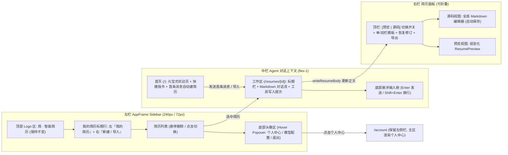

# 简历 Agent 三列工作台重构方案

## 目标与整体架构

将产品体验统一收拢为「每份简历对应独立 Agent 对话上下文」的三列全屏工作台（`h-svh overflow-hidden`）：

- **左栏（保持宽度与折叠机制不变）**：顶部产品 Logo 区域（「简 · 智能简历」）保持原样；下方移除原有导航菜单，改为「我的简历」标题行（右侧放置新建与导入按钮）+ 简历滚动列表；底部用户区支持鼠标 Hover 头像弹出 Popover 菜单进入「个人中心」（保留 `/account` 路由）或退出登录。
- **中栏（沉浸式 Agent 对话区）**：
  - 访问 `/` 时展示元宝式欢迎页（居中问候、快捷提示词气泡、导入 Markdown / 空白简历入口、底部悬浮输入框，发首条消息自动创建简历并进入对应工作台）。
  - 访问 `/resumes/[id]` 时作为主视觉中心，提供居中阅读流、Markdown 消息渲染、`writeResumeBody` 工具执行状态卡片与元宝风格底部输入舱。
- **右栏（简历成品与源码合一面板）**：在 `/resumes/[id]` 右侧常驻（支持折叠收起以获得全宽对话），顶栏内置「预览 / 源码」分段开关，集成单双栏模板切换、恢复修订与导出（PDF / Word）菜单。

---

## 核心改动设计

### 1. 左栏重构与头像 Hover Popover（[src/components/app-frame.tsx](src/components/app-frame.tsx)）

- **全屏三列容器改造**：
  - 外层由 `min-h-screen` 改为 `flex h-svh overflow-hidden bg-[#F6F7FB] text-[#14152B]`，消除整页双滚动条。
  - 为 `AppFrame` 增加布局模式区分：工作台页面（`/` 与 `/resumes/[id]`）使用无外边距全高承载（`fullBleed`），`/account` 保持带顶栏与内边距的独立滚动区（`overflow-y-auto`）。
- **顶部 Logo 区与「我的简历」列表**：
  - **产品 Logo 区保持不变**：顶部 `h-16` 区域保留现有的渐变「简」字图标与「智能简历」文案，不塞入额外操作按钮。
  - **「我的简历」标题行 + 右侧新建/导入**：移除原 `工作台` 分区与 `nav`（`我的简历`、`个人中心` 导航项），改为 `我的简历` 标题行（`flex items-center justify-between`），文案居左，「新建」与「导入」图标按钮排在 `我的简历` 文案右侧。
  - **展开态**：标题行下方为可滚动简历列表（通过 `useQuery({ queryKey: ['resumes'] })` 拉取 `/api/resumes`）；当前路由匹配的简历高亮（`bg-[#EEF0FF] text-[#5A6ACF] font-semibold`）；悬停行时渐显删除图标按钮，复用确认删除 `Dialog`（若删除的是当前打开的简历，删除后 `router.replace('/')`）。
  - **折叠态（`w-[72px]`）**：Logo 区仅显示「简」字图标；下方保留紧凑的新建/导入图标入口与带 `Tooltip`（显示简历标题）的文档图标列表，折叠时也可快速切换简历。
- **左下角头像 Hover Popover**：
  - 使用项目现有的 [src/components/ui/popover.tsx](src/components/ui/popover.tsx)（基于 `@base-ui/react/popover`，原生支持 `<PopoverTrigger openOnHover delay={120} closeDelay={150}>`，同时兼容移动端点击）。
  - 弹出层（`side="top" align="start"`，圆角白卡 + 柔和阴影，对齐元宝左下浮层风格）包含：
    - 用户昵称与邮箱摘要
    - `个人中心`（跳转 `/account`）
    - `模型配置`（跳转 `/account?tab=model`）
    - 分割线 + `退出登录`

### 2. 元宝式新对话欢迎页（[src/components/app-shell.tsx](src/components/app-shell.tsx) 与 [src/lib/pending-prompt.ts](src/lib/pending-prompt.ts)）

- 遵守 `AGENTS.md` 约束，[src/app/page.tsx](src/app/page.tsx) 保持挂载 `app-shell.tsx` 且不复用到其它路由。
- 将 `AppShell` 从旧版卡片/列表大厅重构为元宝风格的「新建简历对话」欢迎视图：
  - 居中展示品牌 Agent 标识与问候标题（如「今天想打磨哪份简历？」）。
  - 提供 3~4 个场景化快捷胶囊气泡（如「从零采访我，生成完整简历」「应届生挖掘实习与项目亮点」「结合目标岗位 JD 定制简历」），点击可填入输入框或直接发起。
  - 居中底部悬浮大输入框：底部工具条内含 `+ 导入 Markdown`（上传 `.md` 创建简历并进入工作区）与 `空白简历`（创建空白简历并以源码模式进入 `/resumes/[id]?mode=source`）。
- **首条消息无缝建简历衔接**（新增轻量客户端工具 [src/lib/pending-prompt.ts](src/lib/pending-prompt.ts)）：
  - 用户在 `/` 输入首条消息发送时：先调用 `POST /api/resumes` 创建新简历 -> 将首条消息按 `resumeId` 存入 `sessionStorage` 队列 -> 刷新 `['resumes']` 列表并跳转 `/resumes/${id}` -> 工作区挂载后通过 `takePendingPrompt(id)` 自动读取并调用 `chat.sendMessage({ text })` 触发流式回复（避免 URL 参数过长及 React StrictMode 重复发送问题）。

### 3. 中栏：沉浸式简历 Agent 对话区（[src/components/agent-chat-pane.tsx](src/components/agent-chat-pane.tsx)）

从 [src/components/workspace-page.tsx](src/components/workspace-page.tsx) 拆出独立的 `'use client'` 组件 `AgentChatPane`：

- **轻量沉浸顶栏（`h-14`）**：
  - 左侧：移动端汉堡菜单按钮（`lg:hidden`）+ 桌面端左栏折叠切换按钮（`PanelLeftClose` / `PanelLeftOpen`）+ 行内无边框感可编辑简历标题 `Input` + 当前状态徽章（正文为空显示 `创建引导`，非空显示 `润色模式`，遵循 ADR-0004）。
  - 右侧：桌面端右栏折叠/展开切换按钮（`PanelRightClose` / `PanelRightOpen`）；小屏端显示 `对话 / 简历` 视图切换分段钮。
- **对话消息流（`max-w-2xl mx-auto`）**：
  - 用户消息采用右对齐圆角胶囊气泡；Agent 回复采用无框文档流排版，使用项目已安装的 `react-markdown` + `remark-gfm` 渲染列表、加粗与结构化提问。
  - **Cursor 风格工具调用反馈**：解析 `UIMessage.parts` 中的 `writeResumeBody` 工具部分，在对话流中渲染紧凑状态卡（如「已更新简历正文 · 点击查看预览」），强化 Agent 协作反馈；流式生成与新消息到达时自动平滑锚定底部。
  - 空消息状态展示针对当前模式（创建 vs 润色）的快捷提示气泡；未配置模型时展示引导卡片直达 `/account?tab=model`。
- **元宝风格底部悬浮输入舱**：
  - 圆角白卡容器（`rounded-2xl border border-[#E7E9F3] shadow-sm focus-within:ring`），内置自适应多行输入、`Enter` 发送 / `Shift + Enter` 换行（带中文输入法 `nativeEvent.isComposing` 保护）、模型状态标识与圆形发送按钮。

### 4. 右栏：预览与 Markdown 源码切换合一面板（[src/components/resume-artifact-pane.tsx](src/components/resume-artifact-pane.tsx) 与 [src/components/resume-preview.tsx](src/components/resume-preview.tsx)）

新增 `'use client'` 组件 `ResumeArtifactPane`，将原有的编辑栏与预览栏合并为最右栏：

- **合一顶栏工具条（`h-14 bg-white border-b border-[#E7E9F3]`）**：
  - **左侧开关切换**：`[预览 | 源码]` 分段切换控件（`role="tablist"` / `radiogroup`）。已有正文的简历默认展示 `预览`；URL 带 `?mode=source`（如点击「空白简历」）时默认打开 `源码`。
  - **右侧文档操作**：源码自动保存状态提示（`保存中…` / `已保存`）、模板选择（`单栏` / `双栏`）、`恢复修订` 按钮（当 `previousBody != null` 时显示）、`导出` 下拉菜单（使用 [src/components/ui/dropdown-menu.tsx](src/components/ui/dropdown-menu.tsx) 收纳导出 PDF 与导出 Word，避免顶栏按钮拥挤换行）。
- **双态内容区**：
  - **预览态**：在 `#F6F7FB` 画布上居中呈现纸张质感的 [src/components/resume-preview.tsx](src/components/resume-preview.tsx)（优化纸张留白、阴影与独立滚动）。
  - **源码态**：全高等宽字体 Markdown 编辑器，保留 600ms 防抖 `PATCH /api/resumes/${id}` 自动保存；当 Agent 调用 `writeResumeBody` 完成并刷新 `['resume', id]` 时，源码与预览内容同步更新。

### 5. 个人中心路由适配（[src/components/account-page.tsx](src/components/account-page.tsx)）

- 保留 `/account` 独立路由并包裹在重构后的 `AppFrame` 中（左栏依旧显示「我的简历」列表，点击任意简历或新建按钮即可切回工作台）。
- 支持读取 URL 查询参数 `?tab=model`（或 `account` / `overview`）作为 `Tabs` 初始激活项，使头像菜单和对话区的「去配置模型」能一键定位到模型配置表单。

### 6. 全场景 Loading 等待动画与骨架屏（Skeleton）体验设计

新增通用骨架屏组件 [src/components/ui/skeleton.tsx](src/components/ui/skeleton.tsx)（基于项目色彩体系 `bg-[#E7E9F3]/70 animate-pulse rounded-md`），全面消除生硬的纯文字「加载中…」：

- **左栏「我的简历」列表 Skeleton**：
  - `resumes` 列表初次拉取（`isLoading`）时，展开态渲染 5 条带图标位与长短错落标题条的脉冲骨架行；折叠态渲染 4 个圆角方形图标骨架。
  - 点击「新建」或「导入」创建简历期间，对应图标按钮切换为 `Loader2 animate-spin` 并防重复点击。
- **工作区 `/resumes/[id]` 初始双栏骨架屏（`WorkspaceSkeleton`）**：
  - 拉取简历详情与历史对话（`resume.isLoading`）时，渲染与真实三列工作台等比例的骨架屏：
    - 中栏骨架：顶栏标题骨架条 + 3 组交错的 User/Agent 气泡骨架 + 底部悬浮输入舱骨架。
    - 右栏骨架：顶栏工具条骨架 + 居中的 A4 纸张容器（内含模拟文首、二级标题与段落的骨架条）。
- **Agent 对话多阶段动态等待动画**：
  - **等待首包思考态（`status === 'submitted'`）**：在消息流末尾立即展示 Agent 头像 + 呼吸三点跳动动画（`bounce` 错峰延迟）与「正在思考…」微光提示，杜绝点击发送后的空白停顿感。
  - **流式生成态（`status === 'streaming'`）**：Agent 正在输出的文本末尾跟随闪烁光标指示器；底部输入舱发送按钮变为流式脉冲加载态。
  - **工具写回简历态（`writeResumeBody` 调用中）**：当检测到工具处于 `input-streaming` / `input-available`（尚未 `output-available`）时，对话流中渲染带旋转 `Loader2` 与流光边框的「正在为你撰写/更新简历正文…」进度卡，同时右栏顶栏展示「AI 正在同步正文…」呼吸徽章；工具执行完成后平滑切换为绿色勾号「已更新简历正文 · 点击查看预览」。
- **右栏与操作按钮反馈动效**：
  - 源码编辑防抖保存状态：在右栏顶栏显示轻量状态指示（`Loader2`「保存中…」-> `Check`「已保存」）。
  - 导出 PDF / Word 与「恢复修订」执行期间，按钮内展示 `Loader2 animate-spin` 并禁用重复触发。

---

## 涉及文件清单

- 新增 [src/components/ui/skeleton.tsx](src/components/ui/skeleton.tsx)：符合项目视觉体系的通用脉冲骨架屏基础组件。
- 修改 [src/components/app-frame.tsx](src/components/app-frame.tsx)：全屏骨架、左栏保留顶部 Logo 区、「我的简历」标题行（右侧新建/导入）、列表加载 Skeleton、左下头像 Hover Popover 菜单。
- 新增 [src/lib/pending-prompt.ts](src/lib/pending-prompt.ts)：首页首条消息创建简历后的跨路由待发送消息暂存与一次性消费。
- 修改 [src/components/app-shell.tsx](src/components/app-shell.tsx)：重构 `/` 为元宝风格沉浸式新建简历对话欢迎页（含创建与发送等待动画）。
- 新增 [src/components/agent-chat-pane.tsx](src/components/agent-chat-pane.tsx)：沉浸式 Agent 对话中栏组件（Markdown 消息流、思考三点动效、工具执行进度卡、悬浮输入舱）。
- 新增 [src/components/resume-artifact-pane.tsx](src/components/resume-artifact-pane.tsx)：右栏简历「预览 / Markdown 源码」切换合一面板（含 AI 同步状态提示、保存状态、模板、恢复修订、导出 Loading）。
- 修改 [src/components/resume-preview.tsx](src/components/resume-preview.tsx)：适配右栏纸张容器样式与空正文引导展示。
- 修改 [src/components/workspace-page.tsx](src/components/workspace-page.tsx)：组装中栏 `AgentChatPane` 与右栏 `ResumeArtifactPane`，提供 `WorkspaceSkeleton` 双栏骨架屏，管理右栏折叠、移动端分栏切换、首条消息自动发送与正文同步。
- 修改 [src/components/account-page.tsx](src/components/account-page.tsx)：适配新版 `AppFrame`、模型配置加载骨架与 `?tab=` 参数直达。
